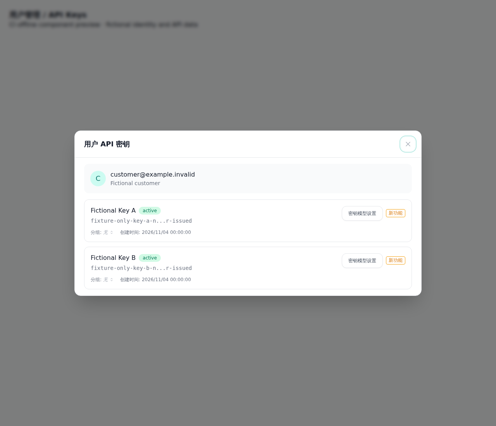
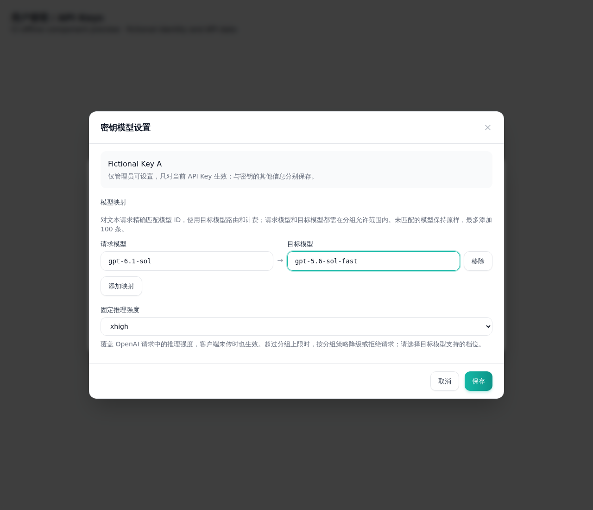
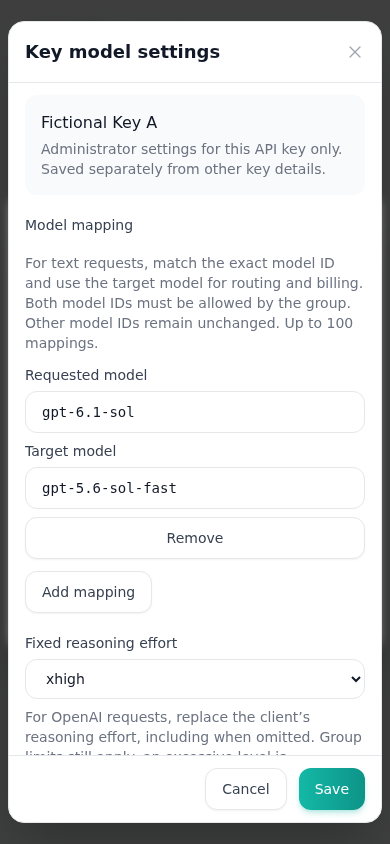

# 单 Key 模型策略截图

来源提交：`52c17cf5087951a7ccac1ebaac239a6192a61416`，对应 [#644](https://github.com/ranxi2001/sub2api/pull/644)。

[成功 CI](https://github.com/ranxi2001/sub2api/actions/runs/41830003914)，artifact `api-key-model-policy-ui-52c17cf5087951a7ccac1ebaac239a6192a61416`。原始 `manifest.json` 包含来源、交互验证、12 PNG 与 `errors: []`。

实际 `UserApiKeysModal → ApiKeyModelPolicyDialog → BaseDialog` 组件链与项目 CSS；身份、内存 API 与客户/Key 数据均为虚构 fixture。中英文覆盖入口、修改与保存回显、显式清空、其他 Key 隔离、390px 窄屏和错误保留编辑。截图是组件链离线验收，不代表整个 Users 导航、真实管理员 API、生产迁移或供应商调用。

