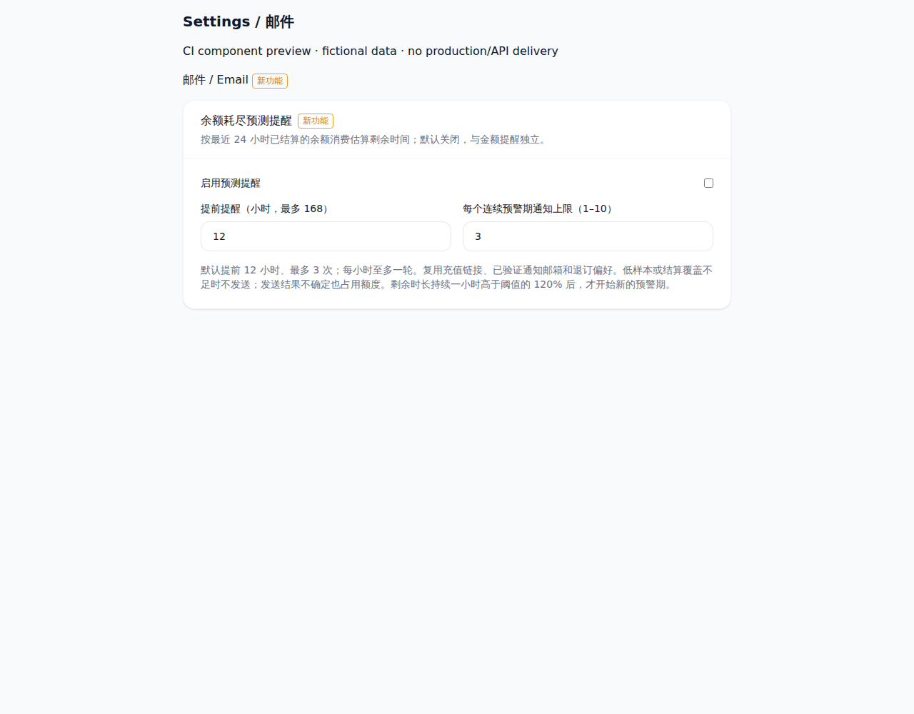
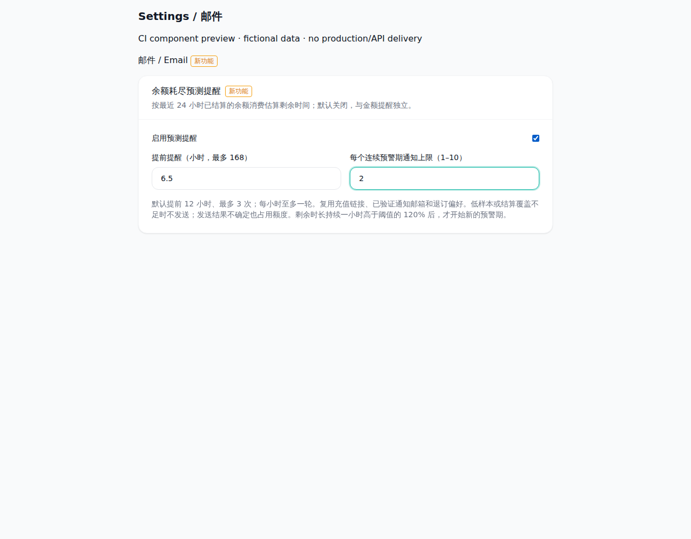
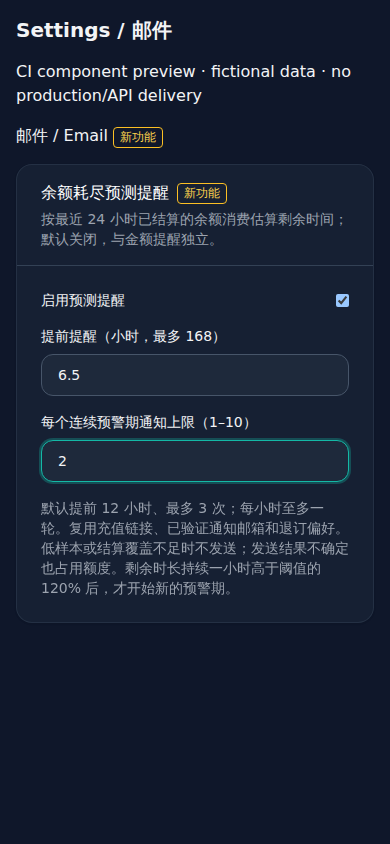

# 余额预测面板截图

来源提交：`60daddaa90175b81fdd5aeff7089f3c5d84b976d`。

[CI 运行](https://github.com/ranxi2001/sub2api/actions/runs/41826772544)，artifact `balance-forecast-ui-60daddaa90175b81fdd5aeff7089f3c5d84b976d`。`manifest.json` 保留原始来源和 `errors: []`。

实际 `BalanceForecastSettings.vue`、`NewFeatureBadge.vue` 和项目 CSS，使用虚构数据的 CI 组件预览。8 张截图覆盖中英文默认/已配置/深色/390px移动状态；预览脚本还验证共享标签关闭和刷新持久化。不能据此声明完整设置页导航、真实管理员 API、真实邮件或生产业务通过。

